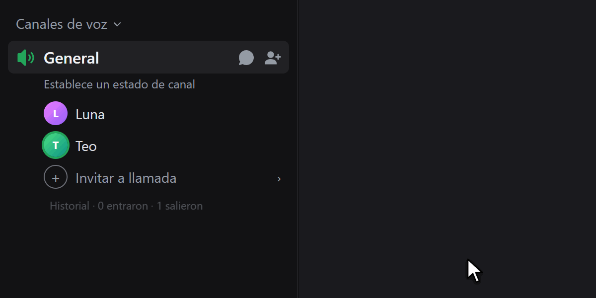

# VoiceLog

¿Alguien se metió a tu llamada, estuvo dos segundos y se fue sin decir nada? Con esto sabes quién fue.

VoiceLog anota quién entra y quién sale del canal de voz donde estás, y a qué hora. Debajo de la gente del canal queda una barrita que casi no se nota; pasas el ratón y te sale la lista. Le das clic a alguien y se abre su perfil.

Sirve para **Vencord** y para **BetterDiscord** ([ver más abajo](#versión-para-betterdiscord)).



<sub>Demostración con nombres y fotos inventados.</sub>

## Índice
1. [Cómo funciona](#cómo-funciona)
2. [Limitaciones](#limitaciones)
3. [Requisitos](#requisitos)
4. [Instalación paso a paso](#instalación-paso-a-paso)
5. [Activar el plugin](#activar-el-plugin)
6. [Actualizar](#actualizar)
7. [Desinstalar](#desinstalar)
8. [Problemas frecuentes](#problemas-frecuentes)
9. [Versión para BetterDiscord](#versión-para-betterdiscord)
10. [Estructura del repositorio](#estructura-del-repositorio)
11. [Aviso](#aviso)

## Cómo funciona
Discord avisa a tu cliente cada vez que alguien entra o sale de un canal de voz. Mientras tú estás en un canal, el plugin anota esos movimientos:

- Debajo de las personas del canal (después de "Invitar a llamada") aparece una línea tenue: `Historial · 2 entraron · 1 salieron`.
- Al pasar el ratón se despliega la lista, de lo más reciente a lo más antiguo. Cada fila tiene la foto, el nombre y las horas: `08:13 → 08:14`, o `08:13 → ahora` si la persona sigue en el canal.
- Las visitas de menos de 15 segundos se marcan con un tono amarillo suave.
- Al hacer clic en una persona se abre su perfil.
- Si todavía no ha entrado nadie, se muestra "Nadie ha entrado aún".

## Limitaciones
- **Solo mientras estás en el canal.** El plugin no puede saber quién entró antes de que llegaras, porque Discord no guarda ese historial.
- **Empieza de cero en cada canal.** Al salir o cambiar de canal de voz, el historial se borra.
- **No se guarda.** Vive en memoria: al cerrar o recargar Discord se pierde.
- **Solo la aplicación de escritorio.** Vencord no funciona en la app del móvil.

## Requisitos
- Windows, macOS o Linux con la aplicación de escritorio de Discord instalada.
- [Node.js LTS](https://nodejs.org) (versión 20 o superior).
- [Git](https://git-scm.com).
- pnpm (se instala con un comando, ver más abajo).
- Conexión a internet para descargar las dependencias (unos 200 MB).

## Instalación paso a paso
Los plugins propios no están en el instalador oficial de Vencord. Los plugins van compilados dentro de Vencord, así que hay que descargar su código fuente, añadir este plugin y volver a compilar. Los ajustes y los plugins que ya tengas no se pierden.

Si ya instalaste otro plugin propio (por ejemplo [LastSeen](https://github.com/ccrccne/vencord-lastseen)), ya tienes Vencord descargado: salta al paso 4.

Los comandos son para Windows (PowerShell). En macOS y Linux son los mismos, salvo la instalación de Node y Git.

### 1. Instalar Node.js y Git
En Windows, con winget:
```bash
winget install OpenJS.NodeJS.LTS Git.Git
```
Cierra la terminal y ábrela de nuevo para que reconozca los programas. Comprueba que funcionan:
```bash
node -v
git --version
```

### 2. Instalar pnpm
```bash
npm i -g pnpm
```

### 3. Descargar Vencord
```bash
git clone https://github.com/Vendicated/Vencord.git
cd Vencord
```

### 4. Descargar este plugin y copiarlo
Descarga este repositorio (botón verde **Code → Download ZIP**, o con `git clone https://github.com/ccrccne/vencord-voicelog.git`).

Copia la carpeta `voiceLog` dentro de `Vencord/src/userplugins/`. Si la carpeta `userplugins` no existe, créala. Debe quedar así:
```
Vencord/
└── src/
    └── userplugins/
        └── voiceLog/
            ├── index.tsx
            └── styles.css
```

### 5. Instalar dependencias y compilar
Dentro de la carpeta `Vencord`:
```bash
pnpm install
pnpm build
```
`pnpm install` tarda unos minutos la primera vez. Si aparecen avisos amarillos (`WARN`) sobre la versión de pnpm o la velocidad de descarga, no son errores.

### 6. Inyectar en Discord
Cierra Discord por completo, incluido el icono de la bandeja del sistema, y ejecuta:
```bash
pnpm inject
```
Es interactivo: te muestra tus instalaciones de Discord y eliges la que quieras con las flechas y Enter. Cuando termine, abre Discord.

## Activar el plugin
1. En Discord, abre **Ajustes de usuario**.
2. En la sección **Vencord Settings**, entra en **Plugins**.
3. Escribe `VoiceLog` en el buscador.
4. Activa el interruptor.

Entra a un canal de voz: debajo de las personas del canal verás la barrita del historial.

## Actualizar
Para actualizar Vencord o este plugin, dentro de la carpeta `Vencord`:
```bash
git pull
pnpm install
pnpm build
pnpm inject
```
Para actualizar solo este plugin, vuelve a copiar la carpeta `voiceLog` a `src/userplugins/` antes de compilar. Como el plugin va compilado dentro de Vencord, hay que repetir la compilación cada vez que Vencord se actualice.

## Desinstalar
- **Solo el plugin:** desactívalo en Ajustes → Vencord → Plugins. Si quieres borrarlo del todo, elimina `src/userplugins/voiceLog`, compila (`pnpm build`) e inyecta de nuevo.
- **Todo Vencord:** con Discord cerrado, ejecuta en la carpeta de Vencord:
  ```bash
  pnpm uninject
  ```

## Problemas frecuentes
- **`node`, `git` o `pnpm` no se reconoce:** cierra y abre la terminal tras instalarlos. Si sigue igual, reinicia el equipo.
- **El plugin no aparece en la lista:** comprueba que la carpeta está en `src/userplugins/voiceLog/index.tsx` (no una carpeta dentro de otra), que ejecutaste `pnpm build` después de copiarla y que volviste a ejecutar `pnpm inject`.
- **El plugin está activado pero no se ve la barrita:** solo aparece en el canal de voz en el que estás conectado. Si aun así no sale, Discord puede haber cambiado esa parte de su interfaz. Abre un *issue* en este repositorio.
- **Error de compilación en `pnpm build`:** Vencord cambia con frecuencia. Si una actualización rompe el plugin, abre un *issue* con el mensaje de error.

## Versión para BetterDiscord
BetterDiscord es otro mod de Discord. Allí los plugins son un único archivo que se copia a una carpeta, sin compilar nada.

Funciona igual que la versión de Vencord: la misma barrita debajo del canal de voz, que se despliega al pasar el ratón y abre el perfil al hacer clic.

### Instalación
1. Instala [BetterDiscord](https://betterdiscord.app) si no lo tienes.
2. Descarga el archivo [`betterdiscord/VoiceLog.plugin.js`](betterdiscord/VoiceLog.plugin.js) de este repositorio (ábrelo y pulsa el botón de descarga, **Download raw file**).
3. En Discord, ve a **Ajustes de usuario → BetterDiscord → Plugins** y pulsa **Open Plugins Folder**.
4. Copia `VoiceLog.plugin.js` en esa carpeta.
5. Vuelve a la lista de plugins y activa **VoiceLog**.

Para actualizarlo, sustituye el archivo por la versión nueva. Para desinstalarlo, desactívalo o borra el archivo de la carpeta de plugins.

Se aplican las mismas [limitaciones](#limitaciones): solo registra mientras estás en el canal y el historial se borra al cambiar de canal o cerrar Discord.

No uses Vencord y BetterDiscord a la vez: instala solo uno de los dos.

## Estructura del repositorio
```
vencord-voicelog/
├── voiceLog/
│   ├── index.tsx             # plugin para Vencord
│   └── styles.css            # estilos de la barrita
├── betterdiscord/
│   └── VoiceLog.plugin.js    # plugin para BetterDiscord
├── images/                   # GIF de demostración
├── .gitignore
└── README.md
```

## Aviso
Los mods de cliente como Vencord y BetterDiscord van contra los Términos de Servicio de Discord. En la práctica rara vez se sanciona su uso, pero el riesgo existe. Este plugin solo lee datos que Discord ya envía a tu cliente y no automatiza ninguna acción. Úsalo bajo tu propia responsabilidad.

Autor: **cancercocaine** (Discord) · [ccrccne](https://github.com/ccrccne) (GitHub)
